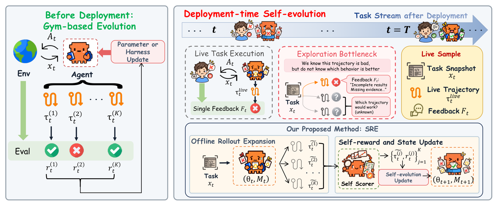
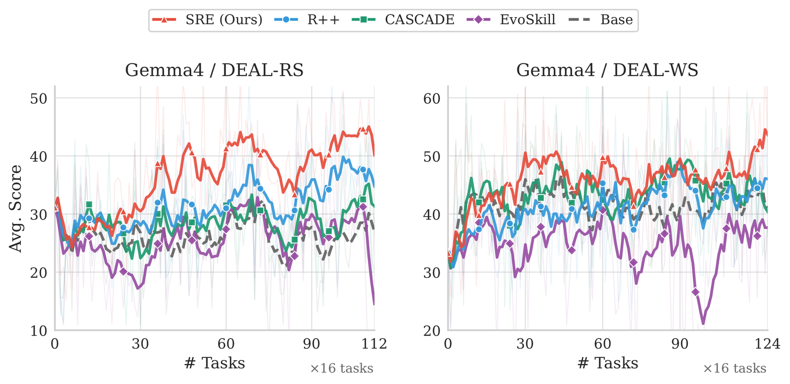
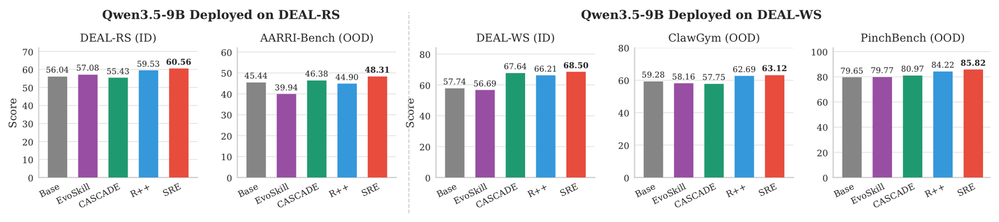

<div align="center">

<h1>Agent Learning from Single-Feedback Deployment Experience</h1>

<p align="center">
  <em><b>DEAL</b>: An executable testbed for deployment-time agent learning &amp; <b>Self-Rewarded Exploration (SRE)</b></em>
</p>

<p align="center">
  
</p>

<p align="center">
  <!-- Uncomment and add assets/badges/arxiv.svg once the arXiv paper page goes live -->
  <a href="https://github.com/trxcc/SRE"></a>
  <a href="https://huggingface.co/collections/trxcc2002/sre-deal"></a>
  <a href="https://huggingface.co/datasets/trxcc2002/DEAL-WS"></a>
  <a href="https://huggingface.co/datasets/trxcc2002/DEAL-RS"></a>
  <a href="https://github.com/trxcc/SRE/actions/workflows/ci.yml"></a>
  <a href="./LICENSE"></a>
</p>

<p align="center">
  <a href="#news">📢 News</a> •
  <a href="#introduction">📖 Introduction</a> •
  <a href="#models-and-datasets">🤗 Models &amp; Datasets</a> •
  <a href="#results">📊 Main Results</a>
</p>
<p align="center">
  <a href="#getting-started">🚀 Getting Started</a> •
  <a href="#evaluation">🧪 Evaluation</a> •
  <a href="#training">🔧 Training</a> •
  <a href="#workspace-demos">🗂️ Workspace Demos</a> •
  <a href="#acknowledgement">✨ Acknowledgement</a> •
  <a href="#citation">📝 Citation</a>
</p>

</div>

---

<a id="news"></a>
## 📢 News

- **[2026/11]** 🎉 We release the official training &amp; evaluation codebase, both benchmark task streams ([`DEAL-WS`](https://huggingface.co/datasets/trxcc2002/DEAL-WS) &amp; [`DEAL-RS`](https://huggingface.co/datasets/trxcc2002/DEAL-RS)), and four trained SRE checkpoints across **Gemma4-E4B-IT** and **Qwen3.5-9B** in our [Hugging Face SRE-DEAL Collection](https://huggingface.co/collections/trxcc2002/sre-deal)!

---

<a id="introduction"></a>
## 📖 Introduction

In real-world deployment, user assistants face a **single-feedback constraint**: tasks arrive sequentially, and the user evaluates only one delivered outcome $F_t = (u_t, c_t)$ per task before moving on.

- **DEAL (*Deployment-time Evaluation of Agent Learning*)**: An executable testbed covering **Workplace Assistance (`DEAL-WS`, 2,000 online / 200 test)** and **AI Research (`DEAL-RS`, 1,800 online / 200 test)**, where agents interact with grounded files and tools through the `nanobot` harness across related task streams.
- **Self-Rewarded Exploration (SRE)**: Single-rollout RL suffers from an *exploration bottleneck* when only one trajectory is evaluated per task. After live execution, SRE asynchronously expands $K = 7$ additional rollouts in isolated copies of the initial task snapshot, uses the frozen initial model $\pi_{\theta_0}$ to build a feedback-anchored rubric $\mathcal{Q}_t$ from $(x_t, \tau_t, F_t)$ and score internal candidates without exposing $F_t$, and applies GRPO updates over the internal self-rewarded rollouts.

---

<a id="models-and-datasets"></a>
## 🤗 Released Models &amp; Datasets

All public artifacts are organized in the [**SRE-DEAL Hugging Face Collection**](https://huggingface.co/collections/trxcc2002/sre-deal).

### Benchmark Datasets

| Dataset | Domain | Online Stream | Held-out Test | Context / Max Output | Hugging Face | Workspace Materialization |
|---|---|---:|---:|---|---|---|
| **DEAL-WS** | Workplace Assistance (Ops, Logistics, Research, Dev, Product) | 2,000 | 200 | 64K / 8K | [`trxcc2002/DEAL-WS`](https://huggingface.co/datasets/trxcc2002/DEAL-WS) | Task overlays bundled + upstream `filesys_en.zip` from [`Workspace-Bench`](https://huggingface.co/datasets/Workspace-Bench/Workspace-Bench-Workspaces) |
| **DEAL-RS** | AI Research (Comp., Align., Verify., Workflow, Audit) | 1,800 | 200 | 72K / 16K (eval: 80K / 16K) | [`trxcc2002/DEAL-RS`](https://huggingface.co/datasets/trxcc2002/DEAL-RS) | Self-contained paper &amp; repo snapshots in `assets/workspaces-*.zip` |

### Released Checkpoints (Last Checkpoints)

| Model | Base Backbone | Domain | Held-out ID | OOD Benchmark(s) | Hugging Face |
|---|---|---|---:|---|---|
| **DEAL-RS-Gemma** | [`google/gemma-4-E4B-it`](https://huggingface.co/google/gemma-4-E4B-it) | AI Research (`DEAL-RS`) | **41.22** *(Base: 21.30)* | AARRI-Bench: **38.60** | [`trxcc2002/DEAL-RS-Gemma`](https://huggingface.co/trxcc2002/DEAL-RS-Gemma) |
| **DEAL-WS-Gemma** | [`google/gemma-4-E4B-it`](https://huggingface.co/google/gemma-4-E4B-it) | Workplace (`DEAL-WS`) | **46.81** *(Base: 40.24)* | PinchBench: **59.54** / ClawGym: **50.27** | [`trxcc2002/DEAL-WS-Gemma`](https://huggingface.co/trxcc2002/DEAL-WS-Gemma) |
| **DEAL-RS-Qwen** | [`Qwen/Qwen3.5-9B`](https://huggingface.co/Qwen/Qwen3.5-9B) | AI Research (`DEAL-RS`) | **60.56** *(Base: 56.04)* | AARRI-Bench: **48.31** | [`trxcc2002/DEAL-RS-Qwen`](https://huggingface.co/trxcc2002/DEAL-RS-Qwen) |
| **DEAL-WS-Qwen** | [`Qwen/Qwen3.5-9B`](https://huggingface.co/Qwen/Qwen3.5-9B) | Workplace (`DEAL-WS`) | **68.50** *(Base: 57.74)* | PinchBench: **85.82** / ClawGym: **63.12** | [`trxcc2002/DEAL-WS-Qwen`](https://huggingface.co/trxcc2002/DEAL-WS-Qwen) |

---

<a id="results"></a>
## 📊 Main Results

### 1. Gemma4-E4B-IT on DEAL-RS &amp; DEAL-WS

<p align="center">
  
</p>

#### AI Research Stream (`DEAL-RS`)

| Method | Online Gain | Comp. | Align. | Verify. | Workflow | Audit | **DEAL-RS Avg. (ID)** | **AARRI-Bench (OOD)** | **General Cap.** |
|---|---:|---:|---:|---:|---:|---:|---:|---:|---:|
| Base (`Gemma4-E4B-IT`) | 0.00 | 16.68 | 27.98 | 33.86 | 14.09 | 18.39 | 21.30 | 35.38 | 52.91 |
| EvoSkill | -1.07 | 26.04 | 29.90 | 34.61 | 19.71 | 24.70 | 26.90 | 30.88 | — |
| CASCADE | +2.49 | 25.52 | 23.93 | 37.30 | 16.38 | 19.59 | 24.93 | 35.25 | — |
| REINFORCE++ | <u>+5.63</u> | <u>31.34</u> | <u>43.40</u> | <u>55.26</u> | **29.68** | <u>29.64</u> | <u>36.95</u> | <u>37.01</u> | <u>52.97</u> |
| **SRE (`DEAL-RS-Gemma`)** | **+10.66** | **36.91** | **47.89** | **55.93** | <u>28.65</u> | **41.63** | **41.22** | **38.60** | **55.16** |

#### Workplace Assistance Stream (`DEAL-WS`)

| Method | Online Gain | Ops. | Log. | Res. | Dev. | Prod. | **DEAL-WS Avg. (ID)** | **PinchBench (OOD)** | **ClawGym-Bench (OOD)** | **General Cap.** |
|---|---:|---:|---:|---:|---:|---:|---:|---:|---:|---:|
| Base (`Gemma4-E4B-IT`) | 0.00 | 48.52 | 44.78 | 38.34 | 37.02 | 32.55 | 40.24 | 55.11 | 46.61 | <u>52.91</u> |
| EvoSkill | -6.50 | 47.58 | 49.22 | 35.35 | 38.61 | 33.74 | 40.90 | 50.87 | 46.86 | — |
| CASCADE | <u>+0.92</u> | **52.50** | <u>51.08</u> | 32.70 | <u>54.84</u> | <u>36.84</u> | <u>45.59</u> | 56.18 | 46.26 | — |
| REINFORCE++ | -0.44 | 42.32 | 44.27 | <u>41.36</u> | **61.31** | 33.42 | 44.54 | <u>57.99</u> | <u>47.44</u> | **52.98** |
| **SRE (`DEAL-WS-Gemma`)** | **+4.54** | <u>49.22</u> | **51.67** | **45.61** | 50.69 | **36.90** | **46.81** | **59.54** | **50.27** | 52.87 |

### 2. Cross-Family Generalization to Qwen3.5-9B

<p align="center">
  
</p>

| Method | **DEAL-RS (ID)** | **AARRI-Bench (OOD)** | **DEAL-WS (ID)** | **ClawGym-Bench (OOD)** | **PinchBench (OOD)** |
|---|---:|---:|---:|---:|---:|
| Base (`Qwen3.5-9B`) | 56.04 | 45.44 | 57.74 | 59.28 | 79.65 |
| EvoSkill | 57.08 | 39.94 | 56.69 | 58.16 | 79.77 |
| CASCADE | 55.43 | <u>46.38</u> | <u>67.64</u> | 57.75 | 80.97 |
| REINFORCE++ | <u>59.53</u> | 44.90 | 66.21 | <u>62.69</u> | <u>84.22</u> |
| **SRE (`DEAL-*-Qwen`)** | **60.56** | **48.31** | **68.50** | **63.12** | **85.82** |

---

<a id="getting-started"></a>
## 🚀 Getting Started

### 1. Environment Installation

See [**INSTALL.md**](INSTALL.md) for system prerequisites (Linux `x86_64`, Python `3.12`, CUDA `12.9` devel, and `claude` CLI on `PATH` for the `DEAL-WS` native judge sidecar) and optional Docker setup.

```bash
git clone https://github.com/trxcc/SRE.git
cd SRE

bash scripts/install.sh
python3 scripts/verify_env.py --mode cpu   # Safe on CPU-only hosts / CI
python3 scripts/verify_env.py --mode all   # Full check on GPU host
python3 scripts/doctor.py --imports
```

### 2. Materialize Benchmark Data (`DEAL-RS` &amp; `DEAL-WS`)

```bash
# Materialize DEAL-RS (1,800 train / 200 held-out eval tasks)
python3 scripts/prepare_data.py \
  --benchmark deal-rs \
  --output ./data/deal-rs

# Materialize DEAL-WS (2,000 train / 200 held-out eval tasks)
# Automatically downloads & verifies filesys_en.zip from Workspace-Bench/Workspace-Bench-Workspaces,
# or pass --workspace-zip /path/to/filesys_en.zip if already downloaded locally.
python3 scripts/prepare_data.py \
  --benchmark deal-ws \
  --output ./data/deal-ws \
  --download-workspace-zip \
  --verify-workspace-zip
```

---

<a id="evaluation"></a>
## 🧪 Evaluation (Reproducing Held-out 200-Task Scores)

`scripts/eval_deal_rs.py` and `scripts/eval_deal_ws.py` evaluate any OpenAI-compatible student endpoint on the 200 held-out test tasks through the native `nanobot` harness, scoring failed or timed-out tasks as `0.0` over the full 200-task denominator (`summary.json`).

### Step 1: Download &amp; Serve a Checkpoint + GT Judge

```bash
# Example A: Serve Gemma4 checkpoint (trxcc2002/DEAL-RS-Gemma or trxcc2002/DEAL-WS-Gemma)
hf download trxcc2002/DEAL-RS-Gemma --local-dir ./checkpoints/DEAL-RS-Gemma
CUDA_VISIBLE_DEVICES=0 bash scripts/serve_frozen_model.sh \
  --model-path ./checkpoints/DEAL-RS-Gemma \
  --model-family gemma4 \
  --served-model-name gemma4-e4b-it \
  --port 8000

# Example B: Serve Qwen3.5 checkpoint (trxcc2002/DEAL-RS-Qwen or trxcc2002/DEAL-WS-Qwen)
hf download trxcc2002/DEAL-RS-Qwen --local-dir ./checkpoints/DEAL-RS-Qwen
CUDA_VISIBLE_DEVICES=0 bash scripts/serve_frozen_model.sh \
  --model-path ./checkpoints/DEAL-RS-Qwen \
  --model-family qwen35 \
  --served-model-name qwen3.5-9b \
  --port 8000
```

Prepare a `chmod 600` API key file for your GT judge endpoint (`google/gemma-4-31B-it` in the paper; can also be self-hosted via `scripts/serve_frozen_model.sh --model-path /path/to/gemma-4-31B-it --model-family gemma4 --tp 2 --port 29050`):

```bash
mkdir -p ./secrets && chmod 700 ./secrets
printf '%s\n' 'YOUR_GT_JUDGE_API_KEY' > ./secrets/gt-api-key
chmod 600 ./secrets/gt-api-key
```

### Step 2: Run Standalone Evaluation

> **Note for Qwen3.5-9B Checkpoints**: Pass `--model-family qwen35 --student-model qwen3.5-9b` when evaluating `DEAL-RS-Qwen` or `DEAL-WS-Qwen` so Qwen3.5 tool schemas and per-task timeouts (`1800s`) are applied.

#### Evaluate on `DEAL-RS` (200 tasks)

```bash
# Gemma4-E4B-IT (DEAL-RS-Gemma)
python3 scripts/eval_deal_rs.py \
  --data-dir ./data/deal-rs \
  --output-dir ./eval-runs/deal-rs-gemma \
  --student-url http://127.0.0.1:8000/v1 \
  --student-model gemma4-e4b-it \
  --model-family gemma4 \
  --judge-url https://YOUR-GT-JUDGE-SERVICE/v1 \
  --judge-model gemma-4-31B-it \
  --judge-api-key-file ./secrets/gt-api-key

# Qwen3.5-9B (DEAL-RS-Qwen)
python3 scripts/eval_deal_rs.py \
  --data-dir ./data/deal-rs \
  --output-dir ./eval-runs/deal-rs-qwen \
  --student-url http://127.0.0.1:8000/v1 \
  --student-model qwen3.5-9b \
  --model-family qwen35 \
  --judge-url https://YOUR-GT-JUDGE-SERVICE/v1 \
  --judge-model gemma-4-31B-it \
  --judge-api-key-file ./secrets/gt-api-key
```

#### Evaluate on `DEAL-WS` (200 tasks, with Deliverable Hardgate)

```bash
# Gemma4-E4B-IT (DEAL-WS-Gemma)
python3 scripts/eval_deal_ws.py \
  --data-dir ./data/deal-ws \
  --output-dir ./eval-runs/deal-ws-gemma \
  --student-url http://127.0.0.1:8000/v1 \
  --student-model gemma4-e4b-it \
  --model-family gemma4 \
  --judge-url https://YOUR-GT-JUDGE-SERVICE/v1 \
  --judge-model gemma-4-31B-it \
  --judge-api-key-file ./secrets/gt-api-key

# Qwen3.5-9B (DEAL-WS-Qwen)
python3 scripts/eval_deal_ws.py \
  --data-dir ./data/deal-ws \
  --output-dir ./eval-runs/deal-ws-qwen \
  --student-url http://127.0.0.1:8000/v1 \
  --student-model qwen3.5-9b \
  --model-family qwen35 \
  --judge-url https://YOUR-GT-JUDGE-SERVICE/v1 \
  --judge-model gemma-4-31B-it \
  --judge-api-key-file ./secrets/gt-api-key
```

---

<a id="training"></a>
## 🔧 Training

### Default Recipe Settings

| Setting | DEAL-WS | DEAL-RS |
|---|---|---|
| **Rollout Group Structure** | **1 GT anchor + 7 SR** (`K=7`, 8 total) | **1 GT anchor + 7 SR** (`K=7`, 8 total) |
| **GT Judge Scope** | Anchor-only (`gt_scope=anchor_only`) | Anchor-only (`gt_scope=anchor_only`) |
| **Deliverable Hardgate** | **Enabled** (`CLAWGYM_ARTIFACT_VALIDITY_GATE=1`) | Enabled |
| **Tool-Result Microcompact** | **Enabled** (`NANOBOT_MICROCOMPACT_ENABLED=1`) | **Disabled** (`NANOBOT_MICROCOMPACT_ENABLED=0`) |
| **Self-Reward Repeats** | 3 sessions (median valid score) | 3 sessions (median valid score) |
| **Online / Test Tasks** | 2,000 / 200 | 1,800 / 200 |
| **Context / Max Output** | 64K / 8K | 72K / 16K (eval: 80K / 16K) |
| **Supported Backbones (`MODEL`)** | `gemma4-e4b-it`, `qwen3.5-9b` | `gemma4-e4b-it`, `qwen3.5-9b` |

> **GPU Allocation**: The bundled recipes under `configs/*.recipe.json` default to a single-node 8-GPU split (`TRAIN_GPUS=0,1,2,3` + `ROLLOUT_GPUS=4,5,6,7`), with the frozen self-reward policy $\pi_{\theta_0}$ and external GT judge accessed via OpenAI-compatible HTTP(S) endpoints. You can adjust `TRAIN_GPUS`, `ROLLOUT_GPUS`, and recipe parallelism/engine settings to match other GPU topologies or multi-node setups.

### Step A: Host the Frozen Self-Reward Policy ($\pi_{\theta_0}$)

```bash
CUDA_VISIBLE_DEVICES=0 bash scripts/serve_frozen_model.sh \
  --model-path /path/to/gemma-4-E4B-it \
  --model-family gemma4 \
  --port 29040
```

### Step B: Configure `.local.env` &amp; API Key Files

```bash
mkdir -p ./secrets && chmod 700 ./secrets
printf '%s\n' 'YOUR_GT_JUDGE_API_KEY' > ./secrets/gt-api-key
printf '%s\n' 'local-frozen-no-auth' > ./secrets/self-reward-api-key
chmod 600 ./secrets/gt-api-key ./secrets/self-reward-api-key

cp configs/deal-rs.env.example configs/deal-rs.local.env
chmod 600 configs/deal-rs.local.env
```

Edit `MODEL` (`gemma4-e4b-it` or `qwen3.5-9b`), `BASE_MODEL`, `DATA_DIR`, `RUN_DIR`, `SELF_REWARD_*`, and `GT_*` in `configs/deal-rs.local.env` (or `configs/deal-ws.local.env`).

### Step C: Preflight Check, Launch &amp; Resume

```bash
# 1. Verify config & optionally probe live self-reward / GT judge endpoints
python3 scripts/verify_env.py --mode all --config configs/deal-rs.local.env --probe-endpoints

# 2. CPU preflight (validates recipe, 1 GT + 7 SR contract, and CLI rendering)
bash scripts/launch.sh --config configs/deal-rs.local.env --check

# 3. Launch asynchronous SRE training
bash scripts/launch.sh --config configs/deal-rs.local.env

# 4. Resume cleanly from the latest committed HF checkpoint + dataset cursor if interrupted
bash scripts/resume_latest.sh --config configs/deal-rs.local.env
```

---

<a id="workspace-demos"></a>
## 🗂️ Workspace Demos (All 4 Agent Roles)

Self-contained workspace layouts illustrating all four agent roles (**`01_exec_agent`**, **`02_gt_judge_agent`**, **`03_self_rubric_agent`**, and **`04_self_scoring_agent`**) and their information-isolation boundaries are provided in [`examples/workspace_demos/README.md`](examples/workspace_demos/README.md):

```bash
python3 scripts/build_workspace_demos.py --verify
```

---

<a id="repository-structure"></a>
## 📦 Repository Structure

```text
.
├── assets/                                 # Overview diagrams, plots, & local SVG badges
├── configs/                                # DEAL-RS & DEAL-WS recipes, .env templates, & constraints
├── runtime/                                # Async Slime + Polar training driver, contracts, & WS judge sidecar
├── scripts/                                # Install, data prep, serving, training launch/resume, & standalone evals
├── examples/workspace_demos/               # Synthetic DEAL-WS & DEAL-RS 4-agent workspace demos
├── vendor/                                 # Integrated RL & harness stack (prorl, reward, nanobot, slime, nemo-rl, megatron-bridge)
└── tests/test_release.py                   # CPU regression, contract, & release-hygiene test suite
```

---

<a id="acknowledgement"></a>
## ✨ Acknowledgement

This work was supported by the Shanghai Artificial Intelligence Laboratory.

This codebase builds upon open-source agent and reinforcement learning infrastructure, including [slime](https://github.com/THUDM/slime), [nanobot](https://github.com/HKUDS/nanobot), [NVIDIA NeMo RL](https://github.com/NVIDIA-NeMo/RL), [Megatron-Bridge / Megatron-LM](https://github.com/NVIDIA/Megatron-LM), [SGLang](https://github.com/sgl-project/sglang), and [Workspace-Bench](https://huggingface.co/datasets/Workspace-Bench/Workspace-Bench-Workspaces). Upstream license notices are preserved in [`NOTICE`](NOTICE) and their respective `vendor/` directories.

---

<a id="citation"></a>
## 📝 Citation

If you find **DEAL** or **SRE** useful in your research, please consider citing our paper:

```bibtex
@article{tan2026deal,
  title={Agent Learning from Single-Feedback Deployment Experience},
  author={Tan, Rong-Xi and Li, Yizhuo and Wang, Wenjie and Qu, Xiaoye and Chen, Qiwei and Zhu, Tong and Luo, Yun and Wang, Zhi and Qian, Chao and Cheng, Yu and Yang, Yang and Li, Yafu},
  year={2026}
}
```
